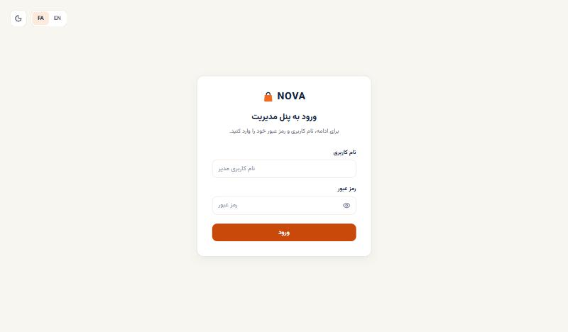
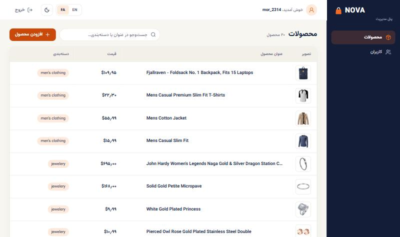
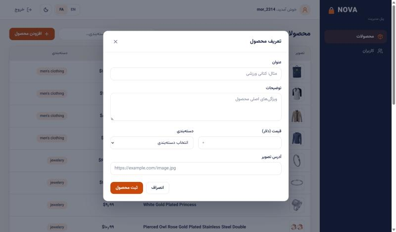
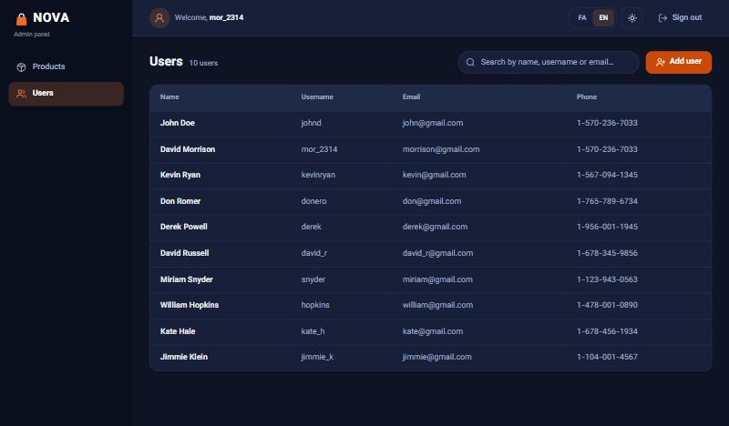

# NOVA Admin

Admin panel of the NOVA store, built for the NOVA frontend technical challenge.
It signs an admin in and manages products and users through the public
[FakeStoreAPI](https://fakestoreapi.com/docs).

## Screenshots

| Login                                     | Products                                        |
| ----------------------------------------- | ----------------------------------------------- |
|  |  |

| Create product                                                | Users (English, dark theme)                                                      |
| ------------------------------------------------------------- | -------------------------------------------------------------------------------- |
|  |  |

## Stack

| Area    | Choice                                            |
| ------- | ------------------------------------------------- |
| Build   | Vite, React 19, TypeScript (strict)               |
| State   | Redux Toolkit (global), `useState` (local)        |
| HTTP    | Axios, one shared `axiosInstance`                 |
| Styling | styled-components with a typed light/dark theme   |
| Forms   | Formik + Yup                                      |
| Routing | React Router                                      |
| i18n    | Typed dictionary (Persian / English), RTL and LTR |
| Tooling | oxlint, Prettier, pnpm                            |

## Getting started

Requirements: Node.js 20.19+ (or 22.12+) and pnpm 10.

```bash
pnpm install
cp .env.example .env
pnpm dev
```

| Script           | Purpose                         |
| ---------------- | ------------------------------- |
| `pnpm dev`       | Development server              |
| `pnpm build`     | Type-check and production build |
| `pnpm preview`   | Serve the production build      |
| `pnpm typecheck` | `tsc -b`                        |
| `pnpm lint`      | oxlint                          |
| `pnpm format`    | Prettier                        |

### Environment

| Variable            | Description                                 |
| ------------------- | ------------------------------------------- |
| `VITE_API_BASE_URL` | Base URL of the API, without trailing slash |

The app fails fast with a clear message when the variable is missing
(`src/Utils/env.ts`). Nothing secret is stored in the repository.

### Signing in

FakeStoreAPI has no admin role; any account returned by its public
`GET /users` endpoint can sign in (for example the user `mor_2314`). The
credentials are listed in the API documentation and are intentionally not
copied into this repository.

## Features

- **Login** with username and password, error feedback, sign out, and guarded
  routes that return the admin to the page they asked for.
- **Products**: table with image, title, price and category; client-side
  search; loading, error (with retry), empty and no-result states.
- **Create product**: modal form (title, description, price, category, image
  URL) validated with Yup; the new row is added to the current list.
- **Users**: table with name, username, email and phone; search and the same
  set of states.
- **Create user**: modal form (first name, last name, username, email,
  password, phone).
- **Persian / English** with automatic RTL/LTR, and **light / dark** theme.
  Both preferences are remembered.

## Folder structure

```
src/
├── assets/          Fonts, Icons, Images
├── Components/      Components that belong to one page (Layout, Login, Products, Users)
├── Dictionary/      fa.ts, en.ts and the useDictionary hook
├── Modals/          Dialogs (create product, create user)
├── Pages/           One folder per route: index.tsx (JSX) + index.hook.ts (logic)
├── Redux/           Store, typed hooks, slices, storage listeners
├── Routes/          Path constants, route table, auth guards
├── Shared/          Reusable UI (Button, FormField, DataTable, Modal, …) and Theme
├── Storage/         Typed wrappers around sessionStorage / localStorage
├── types/           Domain types; Enums/ holds every enum
├── Utils/           UI-independent functions
│   ├── api/         axiosInstance, ApiError, endpoints
│   └── services/    One file per API resource
└── Validations/     Yup schemas
```

The structure follows the one proposed in the challenge. The only addition is
`Shared/Theme`, which holds the theme tokens, the global style and the
styled-components type augmentation; they are shared by every component, so
they live next to the shared UI instead of in a new top-level folder.

## Architecture

Data flows in one direction and no layer is skipped:

```
FakeStoreAPI → axiosInstance → Utils/services → Redux thunk/slice → page hook → component
```

- **`Utils/api/axiosInstance.ts`** is the only HTTP client. Its request
  interceptor attaches the token; its response interceptor converts every
  failure into an `ApiError` with an `ApiErrorCode` enum value. Components
  never see an Axios error.
- **Services** are plain typed functions (`getProducts(): Promise<Product[]>`).
- **Slices** own request status and data. Thunks reject with an
  `ApiErrorCode`, which the UI maps to a translated message through the
  dictionary, so error texts are defined once per language.
- **Page hooks** (`Pages/*/index.hook.ts`) hold all page logic: selectors,
  dispatches, local `useState`, derived data. The page component only renders.
- **Side effects of state** (writing the session and preferences to storage)
  live in a Redux listener middleware, keeping reducers pure.

### State management

| State                            | Where                       |
| -------------------------------- | --------------------------- |
| Session, products, users, toasts | Redux slices                |
| Language and theme               | Redux `settings` slice      |
| Search text, modal open/closed   | `useState` in the page hook |
| Form values and validation       | Formik                      |

### Localization

All UI text comes from `Dictionary/`. `fa.ts` is the source of truth and
`en.ts` is typed against it, so a missing key is a compile error. Validation
schemas are factories that receive the dictionary, so messages follow the
active language. Layout uses CSS logical properties only, which makes RTL and
LTR work from the same styles.

### Token storage

FakeStoreAPI returns the token in the response body and sets no cookie, so an
`HttpOnly` cookie is not available without a backend of our own. The session
is kept in `sessionStorage`: it survives a refresh but is scoped to the tab
and cleared when the tab closes. With a real backend the token should move to
a `Secure; HttpOnly; SameSite` cookie and the storage wrapper would be removed.

## FakeStoreAPI limitations and how they are handled

- **POST does not persist.** After a successful create, the new item is added
  to the list in the Redux store. Lists are fetched once per session, because
  refetching would drop those rows. A full page reload starts from the API
  data again.
- **POST returns the same id every time.** The slice assigns the next free id
  locally when the returned one is already used, so rows keep unique keys.
- **`POST /users` returns only an id.** The service merges the submitted
  fields with it; the password is discarded and never stored client-side.
- **No server-side search or paging.** Search runs on the fetched list.
- **No token validation.** The API accepts every request, but the token is
  still sent and a `401` on an authenticated request signs the admin out.
- **Prices are plain numbers.** They are shown as US dollars, formatted with
  the digits of the active language.

## Assumptions and scope

- Edit and delete are not implemented; the challenge marks them as optional.
- The panel targets desktop widths from 1280px, as allowed by the challenge.
- The reference image shows a dashboard and a settings entry in the sidebar;
  only the required pages (products, users) are implemented.

## Planning and estimate

The table is an estimate of the work, not a log of hours, and it covers both
repositories (NOVA Admin and NOVA Store). The implementation rows are the
estimate the AI assistant gave when I handed it the challenge document. The
last two rows, code review and manual testing, are my own part.

| Part                                                              | Estimate |
| ----------------------------------------------------------------- | -------- |
| Admin: Vite setup, theme, dictionary, axios instance, Redux store | 0.75 h   |
| Admin: login, route guards, sidebar and header layout             | 0.75 h   |
| Admin: product and user lists and forms (Formik + Yup)            | 1.5 h    |
| Store: Next.js setup, next-intl, proxy, SSR styling, theme        | 1 h      |
| Store: landing page, categories, search, sorting, pagination      | 1.5 h    |
| Store: cart with Zustand persist, metadata, robots, sitemap       | 0.75 h   |
| Both: browser checks (fa/en, light/dark, three widths), README    | 1 h      |
| Code review of both projects                                      | 3 h      |
| Manual testing of every flow                                      | 1.75 h   |
| **Total**                                                         | **12 h** |

### How I work with AI assistants

I use Claude as a tool inside a process I control. On my own product the
process is:

- **Two roles.** A coordinator session holds the context: the roadmap, the
  architecture decisions and the conventions. It writes the task for each
  phase. A separate builder session (Claude Code inside the repository)
  implements one phase per fresh session.
- **Decisions are mine.** Product and architecture decisions are written down
  before any code: a roadmap, decision records and a conventions file. The
  builder works from those documents and is expected to stop and ask when
  they do not answer a question.
- **Every phase is reviewed.** The builder reports what it changed, with
  screenshots. I check the result myself, and the coordinator reviews the
  report against the plan before the next phase starts. When a builder drifts
  from the plan, I stop it and the change is redone.
- **Hard rules.** No secrets in chat or code, destructive operations are done
  by me, and lint, type-check and tests pass before a commit.

### How this challenge was built

The challenge is much smaller than a product, so I ran a shorter version of
that process:

- **Inputs.** The challenge document was the specification and the conventions
  of my own codebase were the rules. The stack and the folder structure were
  fixed by the document.
- **One builder session.** After I approved its breakdown and estimate (the
  table above), a single Claude Code session generated both projects on
  10 November in about an hour. Implementation details the document left open
  were settled in that session and are listed under "Folder structure" and
  "Assumptions and scope".
- **Verification.** The session ran lint, type-check and build and checked
  every page in a browser, in both languages, both themes and three widths. I
  tested login and user creation by hand. Both repositories were also cloned
  fresh and installed from the README.
- **History.** The work was committed in logical steps at the end of that
  session, which is why the initial commits of each project share one
  timestamp. The later commits are documentation and repository housekeeping,
  not changes to application code.
